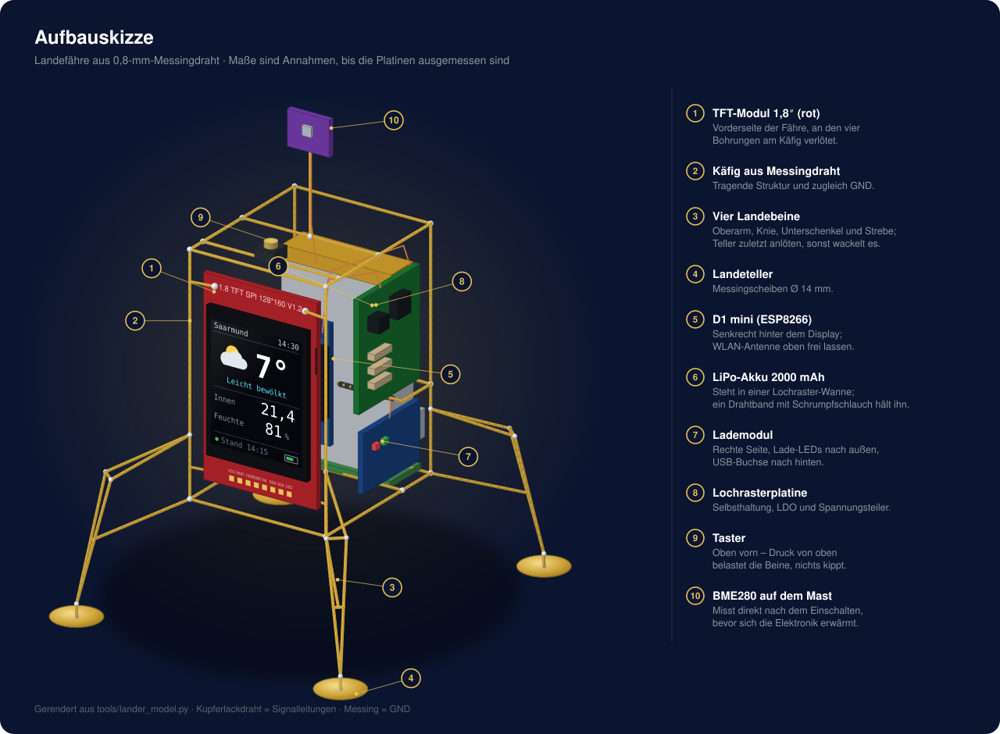
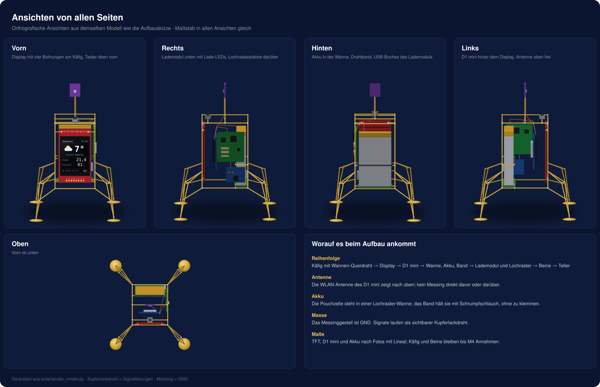
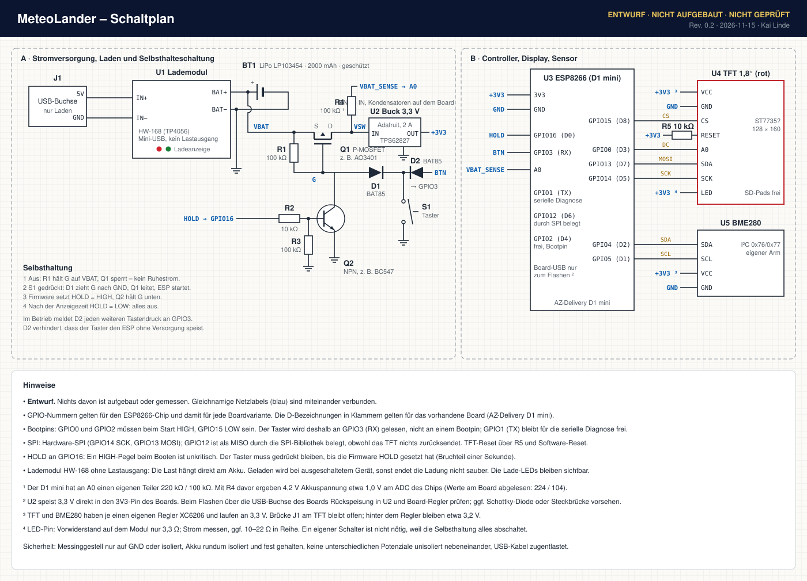
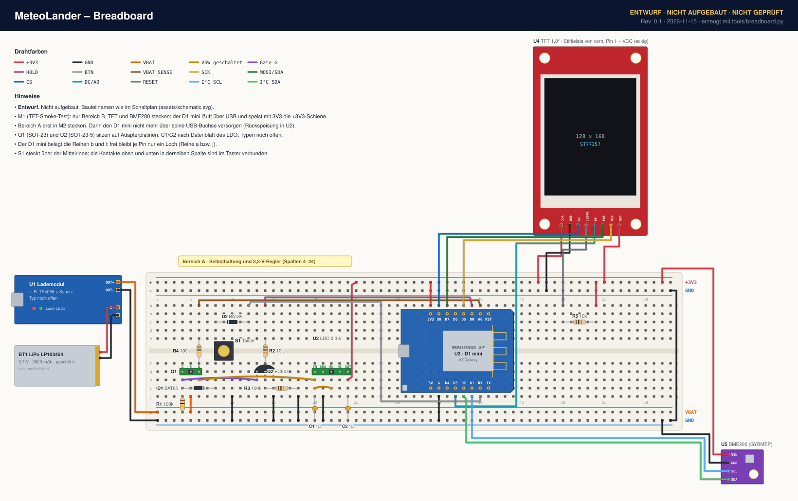

  

  
  
  
  
  
  

  <b>Das Wetter vor der Haustür – als kleines Objekt aus Messing, Kupfer und sichtbarer Elektronik.</b> 
  Auf Knopfdruck holt ein ESP8266 die Daten von <a href="https://open-meteo.com/">Open-Meteo</a> und zeigt sie auf einem roten 1,8″-TFT, 
  das in einer kleinen Landefähre aus Messingdraht sitzt. Akkubetrieben, ohne Gehäuse, ohne App, ohne Webserver.

---

> [!NOTE]
> **Konzeptphase.** Dieses Repository enthält Planung, Gestaltung, Dokumentation und einen ersten Testsketch.
> Die vorhandenen Teile sind bestimmt und ausgemessen (M0); Regler und Transistoren für die Selbsthaltung werden noch
> beschafft. Die eigentliche Firmware gibt es noch nicht. Alle Bilder sind Entwürfe und werden durch Fotos und
> Screenshots des echten Geräts ersetzt, sobald es sie gibt.

## ✨ Idee

| | |
|---|---|
| 🌡️ **Ein Blick genügt** | Große Temperatur, ein klares Wettersymbol, darunter nur Luftfeuchte und Wind. |
| 📅 **Heute & morgen** | Zweite Ansicht mit Höchst-/Tiefstwerten und Regenwahrscheinlichkeit. |
| 🕰️ **Richtige Uhrzeit** | NTP mit Zeitzone Europe/Berlin, Sommer- und Winterzeit automatisch. |
| 🧊 **Ehrliche Anzeige** | Veraltete Werte, fehlendes WLAN oder API-Fehler werden sichtbar markiert – nie erfundene Daten. |
| 🔘 **Auf Knopfdruck** | Ein Druck auf den Taster: frische Daten, 5–10 Minuten Anzeige, danach schaltet sich das Gerät selbst ab. |
| 🔋 **Wochen mit einer Ladung** | Akku mit Selbsthalteschaltung statt Deep Sleep – ausgeschaltet fließt praktisch kein Strom. |
| 🏠 **Drinnen & draußen** | Ein BME280 auf eigenem Messingarm misst Temperatur, Luftfeuchte und Luftdruck im Raum. |
| 🪡 **Circuit Sculpture** | Offenes, tragendes Messinggestell mit wenigen Standbeinen; das rote Displaymodul bleibt sichtbar. |

## 📱 Displayansichten

  

Der Entwurf hält sich an das echte Pixelraster: 128 × 160 Pixel im Hochformat, Schriftzellen des GFX-Standardfonts.
Die Werte sind Beispiele. Ob das Layout am realen Display gut lesbar ist, wird in Meilenstein M3 mit Fotos geprüft.

## 🚀 Aufbau: eine Landefähre aus Messing

  

Ein Käfig aus 1-mm-Messingdraht trägt vorn das rote Display, dahinter senkrecht den ESP8266 und den Akku.
Vier Landebeine mit Messingtellern halten die Fähre, der BME280 sitzt oben auf dem Mast.
Die Form ist inspiriert vom [Boron Lander](https://www.hackster.io/mohit/boron-lander-7f08b5) von Mohit Bhoite. Messing ist GND,
Signale laufen als sichtbarer Kupferlackdraht. Die Grafiken werden aus einem kleinen 3D-Modell erzeugt
([tools/lander_model.py](tools/lander_model.py)), damit sie nach dem Ausmessen mit echten Maßen neu entstehen.

  

Dieselbe Fähre von allen Seiten: Von hinten sieht man den Akku in seiner Wanne mit dem Drahtband, von rechts
Lademodul und Lochrasterplatine, von links den D1 mini mit freier Antenne.

## 📐 Bauzeichnung 1:1 zum Ausdrucken

**[assets/build-drawing.pdf](assets/build-drawing.pdf)** – zwei A4-Blätter im Maßstab 1:1. Die Drähte sind in ihrer
echten Stärke gezeichnet: ausdrucken, Draht auflegen, mit Malerkrepp fixieren, biegen und löten.

| Blatt 1 – Käfig | Blatt 2 – Landebeine |
|---|---|
|  |  |
| Boden- und Deckrahmen, Akkuwanne und Akku-Band, Vorderansicht mit Display-Haltern, Längenlehren, Zuschnittliste | Aufstellplan mit Tellervorlagen, Bein von der Seite und von außen, Biegeschablone für die Holme, Bauablauf |

> [!IMPORTANT]
> Im Druckdialog **„Tatsächliche Größe“ bzw. 100 %** wählen, nicht „An Seite anpassen“. Danach die Kontrollstrecken
> (100 mm waagerecht, 50 mm senkrecht) nachmessen. Die Platinenmaße sind mit dem Messschieber gemessen, der Akku ist
> nach Typangabe bemaßt; Käfig- und Beinmaße sind Entwurf und werden nach einem Probeaufbau festgelegt.

Erzeugt mit [tools/build_drawing.py](tools/build_drawing.py) aus denselben Maßen wie das 3D-Modell.

## 🔌 Schaltplan

  

Ein Tastendruck schaltet über einen P-MOSFET ein, der ESP8266 hält sich selbst und trennt sich nach der Anzeigezeit
wieder vollständig vom Akku. Die Lade-LEDs des Lademoduls sitzen sichtbar an der Seite der Fähre. Der Plan ist ein **Entwurf**:
Pinbelegung und Begründung stehen in [docs/wiring.md](docs/wiring.md).

## 🧪 Testaufbau auf dem Breadboard

  

Bevor gelötet wird, entsteht die Schaltung auf einem Steckbrett mit 830 Kontakten. Bauteilnamen und Drahtfarben passen
zum Schaltplan. Für den ersten Displaytest (M1) reicht der rechte Teil: D1 mini über USB, dazu TFT und BME280.
Die Selbsthalteschaltung links kommt in M2 dazu. Erzeugt wird die Zeichnung von [tools/breadboard.py](tools/breadboard.py).

## 🧰 Hardware

| Teil | Beschreibung | Status |
|---|---|---|
| Controller | AZ-Delivery D1 mini mit ESP-12F | ✅ bestimmt |
| Display | Rotes 1,8″-SPI-TFT, Aufdruck `1.8 TFT SPI 128*160 V1.2`, 34 × 58 mm, mit microSD-Slot | Controller vermutlich ST7735S, Test in M1 |
| Gestell | Käfig und vier Landebeine aus 1-mm-Messingdraht, Landeteller Ø 14 mm | Bauzeichnung 1:1, Probeaufbau in M4 |
| Sensor | GYBMEP-Modul mit BME280 (Temperatur, Feuchte, Luftdruck) | Chip-ID noch prüfen (BME- oder BMP280) |
| Akku | EEMB LP103454, LiPo 3,7 V, 2000 mAh, mit Schutzplatine | ✅ bestimmt |
| Laden & Regler | Lademodul HW-168 (TP4056, Mini-USB), Schaltregler Adafruit TPS62827 (3,3 V, 2 A) | Lademodul vorhanden, Regler zu beschaffen |
| Einschalten | Taster 6 × 6 mm mit Selbsthalteschaltung (P-MOSFET AO3401, NPN BC547) | Taster vorhanden, Transistoren zu beschaffen |

Details, Fotos und offene Prüfpunkte: [docs/hardware.md](docs/hardware.md) · Verdrahtung: [docs/wiring.md](docs/wiring.md) ·
vollständige Teileliste: [docs/parts-list.md](docs/parts-list.md) (auch als [CSV](docs/parts-list.csv))

## 🗺️ Fahrplan

| | Meilenstein | Inhalt |
|---|---|---|
| ✅ | **M0 – Hardware verifizieren** | Boardvariante, Pinout, Maße und Befestigungspunkte – Restpunkte brauchen den Probelauf |
| ⏳ | **M1 – Smoke-Test** | Testmuster, Farben und Umlaute auf dem Display, Chip-ID des BME280, WLAN – Sketch liegt bereit |
| ⬜ | **M2 – Daten & Strom** | WLAN, Zeitabgleich, Open-Meteo, BME280, Selbsthalteschaltung, Akkustand |
| ⬜ | **M3 – Displaydesign** | Ansichten „Aktuell“ und „Prognose“, beurteilt am echten Display |
| ⬜ | **M4 – Circuit Sculpture** | 1:1-Bauzeichnung mit gemessenen Maßen, Prototyp, sichere Verdrahtung |
| ⬜ | **M5 – Endtest** | Einschaltzyklen, Akkulaufzeit, WLAN- und API-Ausfall, Abschlussdoku |

## 📚 Dokumentation

| Datei | Inhalt |
|---|---|
| [docs/hardware.md](docs/hardware.md) | Bauteile mit Fotos, bekannte Daten, offene Prüfungen |
| [docs/parts-list.md](docs/parts-list.md) | Teileliste: Elektronik, Breadboard, Mechanik ([CSV](docs/parts-list.csv)) |
| [docs/wiring.md](docs/wiring.md) | Anschlussplan, Schaltplan und Breadboard |
| [docs/design.md](docs/design.md) | Gestaltung von Gestell und Display, 1:1-Bauzeichnung |
| [docs/software.md](docs/software.md) | Architektur, Datenquellen, Bibliotheken |
| [docs/test-plan.md](docs/test-plan.md) | Testfälle je Meilenstein |
| [firmware/SmokeTest](firmware/SmokeTest/SmokeTest.ino) | Testsketch für den ersten Probelauf (M1) |
| [docs/changelog.md](docs/changelog.md) | Änderungen und Entscheidungen |

## 🙏 Inspiration

Die Bauform von MeteoLander ist inspiriert vom
**[Boron Lander](https://www.hackster.io/mohit/boron-lander-7f08b5)** von
[Mohit Bhoite](https://bhoite.com/) – einer wunderschönen Circuit Sculpture in Form einer Landefähre.
Seine Arbeiten haben gezeigt, wie viel Charakter freie Messingdrahtkonstruktionen und sichtbare Elektronik haben
können. Danke für die Inspiration!

## 🌦️ Wetterdaten

Wetterdaten von [Open-Meteo.com](https://open-meteo.com/), lizenziert unter
[CC BY 4.0](https://creativecommons.org/licenses/by/4.0/). Die kostenlose API ist für nichtkommerzielle Nutzung gedacht.

## 📄 Lizenz

[MIT](LICENSE) © 2026 Kai Linde
