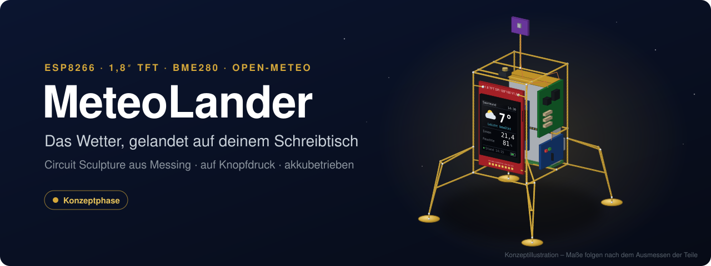
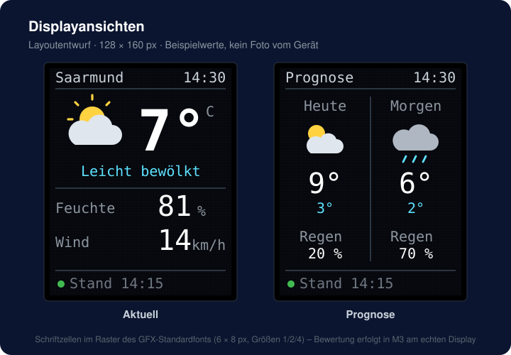
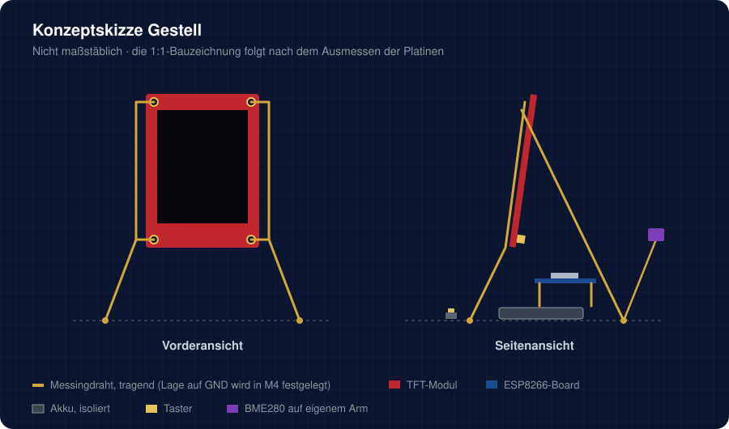

  

  
  
  
  
  
  

  <b>Das Wetter vor der Haustür – als kleines Objekt aus Messing, Kupfer und sichtbarer Elektronik.</b> 
  Auf Knopfdruck holt ein ESP8266 die Daten von <a href="https://open-meteo.com/">Open-Meteo</a> und zeigt sie auf einem roten 1,8″-TFT, 
  das frei in einem offenen Drahtgestell steht. Akkubetrieben, ohne Gehäuse, ohne App, ohne Webserver.

---

> [!NOTE]
> **Konzeptphase.** Dieses Repository enthält bisher Planung, Gestaltung und Dokumentation. Die Hardware ist noch nicht
> ausgemessen, es gibt noch keine Firmware. Alle Bilder sind Entwürfe und werden durch Fotos und Screenshots des echten
> Geräts ersetzt, sobald es sie gibt.

## ✨ Idee

| | |
|---|---|
| 🌡️ **Ein Blick genügt** | Große Temperatur, ein klares Wettersymbol, darunter nur Luftfeuchte und Wind. |
| 📅 **Heute & morgen** | Zweite Ansicht mit Höchst-/Tiefstwerten und Regenwahrscheinlichkeit. |
| 🕰️ **Richtige Uhrzeit** | NTP mit Zeitzone Europe/Berlin, Sommer- und Winterzeit automatisch. |
| 🧊 **Ehrliche Anzeige** | Veraltete Werte, fehlendes WLAN oder API-Fehler werden sichtbar markiert – nie erfundene Daten. |
| 🔘 **Auf Knopfdruck** | Ein Druck auf den Taster: frische Daten, 5–10 Minuten Anzeige, danach schaltet sich das Gerät selbst ab. |
| 🔋 **Wochen mit einer Ladung** | Akku mit Selbsthalteschaltung statt Deep Sleep – ausgeschaltet fließt praktisch kein Strom. |
| 🏠 **Drinnen & draußen** | Ein BME280 auf eigenem Messingarm misst Temperatur, Luftfeuchte und Luftdruck im Raum. |
| 🪡 **Circuit Sculpture** | Offenes, tragendes Messinggestell mit wenigen Standbeinen; das rote Displaymodul bleibt sichtbar. |

## 📱 Displayansichten

  

Der Entwurf hält sich an das echte Pixelraster: 128 × 160 Pixel im Hochformat, Schriftzellen des GFX-Standardfonts.
Die Werte sind Beispiele. Ob das Layout am realen Display gut lesbar ist, wird in Meilenstein M3 mit Fotos geprüft.

## 🪡 Aufbau

  

Das Displaymodul hängt an seinen vier Befestigungsbohrungen in einem Rahmen aus Messingdraht, der zugleich die Standbeine bildet.
Das ESP8266-Board sitzt dahinter auf eigenen Drahtstützen, der Akku isoliert im Sockel, der BME280 auf einem eigenen Arm. Zum Bauen gibt es eine **Zeichnung im Maßstab 1:1** mit einer
100-mm-Kontrollstrecke, auf die die Drähte direkt gelegt und gebogen werden können. Sie entsteht, sobald beide Platinen
ausgemessen sind (siehe [docs/design.md](docs/design.md)).

## 🧰 Hardware

| Teil | Beschreibung | Status |
|---|---|---|
| Controller | ESP8266-Entwicklungsboard (blau) | Variante noch zu bestimmen |
| Display | Rotes 1,8″-SPI-TFT, Aufdruck `1.8 TFT SPI 128*160 V1.2`, mit microSD-Slot | Controller vermutlich ST7735, noch zu prüfen |
| Gestell | Messing-/Kupferdraht | Stärken und Maße folgen in M4 |
| Sensor | BME280 (Temperatur, Feuchte, Luftdruck) | vorhanden, Modul noch zu prüfen |
| Akku & Laden | Li-Ion/LiPo-Zelle mit Schutz, USB-Lademodul, 3,3-V-Regler | Auswahl nach Werkstattbestand |
| Einschalten | Taster mit Selbsthalteschaltung (P-MOSFET) | Bauteile noch festzulegen |

Details und offene Prüfpunkte: [docs/hardware.md](docs/hardware.md) · Verdrahtung: [docs/wiring.md](docs/wiring.md)

## 🗺️ Fahrplan

| | Meilenstein | Inhalt |
|---|---|---|
| ⏳ | **M0 – Hardware verifizieren** | Boardvariante, Displaycontroller, Pinout, Maße und Befestigungspunkte |
| ⬜ | **M1 – TFT-Smoke-Test** | Schriftzug, Testmuster und Farben auf dem originalen Display |
| ⬜ | **M2 – Daten & Strom** | WLAN, Zeitabgleich, Open-Meteo, BME280, Selbsthalteschaltung, Akkustand |
| ⬜ | **M3 – Displaydesign** | Ansichten „Aktuell“ und „Prognose“, beurteilt am echten Display |
| ⬜ | **M4 – Circuit Sculpture** | 1:1-Bauzeichnung, Materialliste, Prototyp, sichere Verdrahtung |
| ⬜ | **M5 – Endtest** | Einschaltzyklen, Akkulaufzeit, WLAN- und API-Ausfall, Abschlussdoku |

## 📚 Dokumentation

| Datei | Inhalt |
|---|---|
| [docs/hardware.md](docs/hardware.md) | Bauteile, bekannte Daten, offene Prüfungen |
| [docs/wiring.md](docs/wiring.md) | Anschlussplan (wird erst nach Verifikation festgelegt) |
| [docs/design.md](docs/design.md) | Gestaltung von Gestell und Display, Plan für die 1:1-Zeichnung |
| [docs/software.md](docs/software.md) | Architektur, Datenquellen, Bibliotheken |
| [docs/test-plan.md](docs/test-plan.md) | Testfälle je Meilenstein |
| [docs/changelog.md](docs/changelog.md) | Änderungen und Entscheidungen |

## 🌦️ Wetterdaten

Wetterdaten von [Open-Meteo.com](https://open-meteo.com/), lizenziert unter
[CC BY 4.0](https://creativecommons.org/licenses/by/4.0/). Die kostenlose API ist für nichtkommerzielle Nutzung gedacht.

## 📄 Lizenz

[MIT](LICENSE) © 2026 Kai Linde
