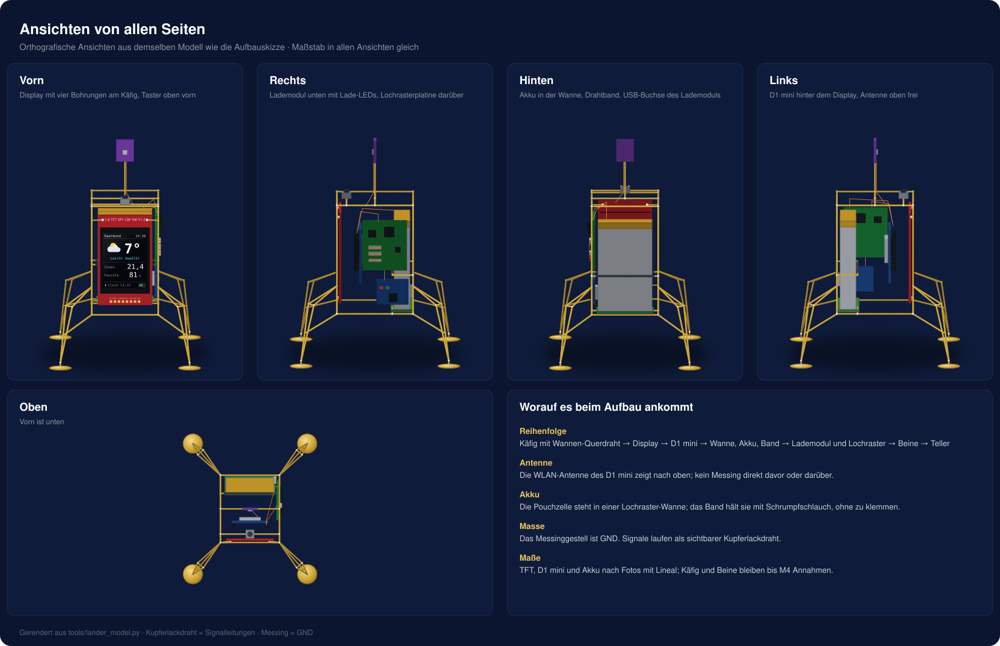
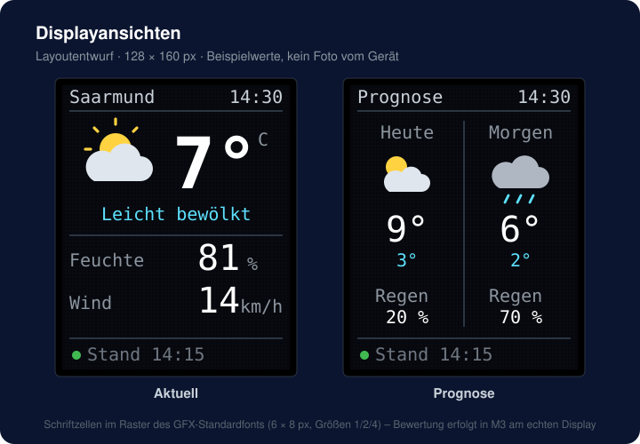

# Gestaltung

## Leitidee

MeteoLander ist eine kleine Landefähre aus Messingdraht, die auf dem Schreibtisch „gelandet“ ist: ein offener Käfig
mit dem roten Display vorn, vier gespreizte Landebeine mit runden Tellern und oben ein Mast mit dem Klimasensor.
Die Elektronik ist Teil der Form und wird nicht versteckt. Der Draht ist zugleich Struktur und Masseleitung.

Inspiriert vom [Boron Lander](https://www.hackster.io/mohit/boron-lander-7f08b5) von Mohit Bhoite.

## Fähre

- **Käfig:** Quader aus 0,8-mm-Messingdraht (12 Kanten), Größe ergibt sich aus Display, ESP8266 und Akku.
- **Display:** Das TFT-Modul bildet die Vorderseite und ist an seinen **vier Bohrungen** mit dem Käfig verlötet.
  Die Platine wird nicht verändert.
- **ESP8266:** senkrecht direkt hinter dem Display. Die WLAN-Antenne bleibt frei – kein Messing darüber oder davor.
- **Akku:** hinten im Käfig, rundum isoliert und mit Drahtbügeln fixiert; berührt das Messing nirgends blank.
- **Lademodul:** an der rechten Seite, Lade-LEDs nach außen sichtbar, USB-Buchse nach hinten.
- **Lochrasterplatine:** rechte Seite oben; Selbsthaltung, LDO und Spannungsteiler.
- **Taster:** oben vorn auf einer Querstrebe. Gedrückt wird von oben, das belastet die Beine und nichts kippt.
- **BME280:** auf einem Mast über dem Käfig. Er misst direkt nach dem Einschalten, solange die Elektronik kalt ist.
- **Landebeine:** je Ecke Oberarm, Knie, Unterschenkel und Strebe; unten ein Messingteller Ø 14 mm.
  Die Teller werden zuletzt angelötet, sonst wackelt die Fähre.
- **Verbindungen:** sichtbarer Kupferlackdraht; das Messing führt GND.

Die Grafiken werden aus `tools/lander_model.py` erzeugt. Alle Maße stehen dort im Abschnitt `MASSE` und sind bis zum
Ausmessen der Platinen Annahmen. Drahtstärken, Beinwinkel und Gesamthöhe werden in M4 festgelegt.
Sicherheitsregeln siehe [wiring.md](wiring.md).

## Bautechnik

- Biegen und Löten auf der ausgedruckten 1:1-Zeichnung, Drähte mit Malerkrepp fixieren.
- Erst Käfig, dann Display und Platinen, dann Beine, zum Schluss die Teller.
- Flussmittelstift für jede Lötstelle, danach mit feiner Stahlwolle reinigen.
- Jedes Teilsystem vor dem Einbau auf dem Steckbrett testen.

## 1:1-Bauzeichnung (geplant für M4)

Die Bauzeichnung entsteht aus den gemessenen Maßen beider Platinen. Sie ist zugleich Biegeschablone: Drähte werden direkt
auf den Ausdruck gelegt.

- **Format:** SVG als Quelle, PDF auf A4 zum Drucken
- **Inhalt:** Draufsicht als Biegeschablone, Seitenansicht mit Neigung, Bohrungspositionen, Lötpunkte, Drahtlängen
- **Kontrollstrecke 100 mm:** nach dem Drucken nachmessen. Im Druckdialog „Tatsächliche Größe“ bzw. 100 % wählen,
  nicht „An Seite anpassen“.
- **Materialliste:** Drahtstärken, Längen, Isolierung, Befestigung

## Display

- Harte Grenze: 128 × 160 Pixel im Hochformat
- Dunkler Hintergrund; Weiß für Werte, dezentes Cyan für Zustand und Tiefstwerte, Gelb für die Sonne
- Temperatur groß (GFX-Schriftgröße 4), höchstens zwei bis drei weitere Werte
- Kopfzeile mit Ort bzw. Ansicht und Uhrzeit; Fußzeile mit Datenstand und Statuspunkt
  (grün = aktuell, gelb = veraltet, rot = Fehler)
- Deutsche Beschriftung, metrische Einheiten
- Offener Punkt: Darstellung von Umlauten im GFX-Standardfont (CP437-Modus) im Smoke-Test prüfen
- Neu: Innenwerte vom BME280 und Akkustand kommen hinzu. Der Layoutentwurf wird in M3 entsprechend erweitert;
  Innenwerte erscheinen sofort nach dem Einschalten, die Wetterdaten folgen nach wenigen Sekunden.
