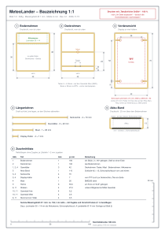
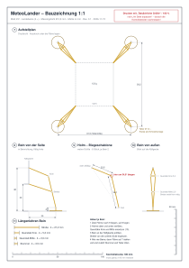

# Gestaltung

## Leitidee

MeteoLander ist eine kleine Landefähre aus Messingdraht, die auf dem Schreibtisch „gelandet“ ist: ein offener Käfig
mit dem roten Display vorn, vier gespreizte Landebeine mit runden Tellern und oben ein Mast mit dem Klimasensor.
Die Elektronik ist Teil der Form und wird nicht versteckt. Der Draht ist zugleich Struktur und Masseleitung.

Inspiriert vom [Boron Lander](https://www.hackster.io/mohit/boron-lander-7f08b5) von Mohit Bhoite.

## Fähre

- **Käfig:** Quader aus 1-mm-Messingdraht (12 Kanten), Größe ergibt sich aus Display, ESP8266 und Akku.
- **Display:** Das TFT-Modul bildet die Vorderseite und ist an seinen **vier Bohrungen** mit dem Käfig verlötet.
  Die Platine wird nicht verändert.
- **ESP8266:** senkrecht direkt hinter dem Display. Die WLAN-Antenne bleibt frei – kein Messing darüber oder davor.
- **Akku:** steht hochkant hinten im Käfig in einer **Akkuwanne** aus Lochraster (36 × 14 mm). Sie liegt auf einem
  zusätzlichen Querdraht im Bodenrahmen und auf dem hinteren Rahmendraht und ist über ihre Kupferpads angelötet.
  Ein **Akku-Band** – eine Drahtschlaufe 42 × 13 mm, 25 mm über dem Bodenrahmen, an den hinteren Senkrechten
  verlötet – hält die Zelle oben. Es trägt vorn und hinten Schrumpfschlauch und liegt nur an, ohne zu klemmen.
  Die Höhe liegt genau zwischen Lademodul und Lochrasterplatine. Der Schwerpunkt der Fähre liegt damit etwa 31 mm
  hinter der Vorderkante, sicher innerhalb der Landeteller (−23 bis +71 mm).
- **Lademodul:** HW-168 an der rechten Seite, Lade-LEDs nach außen sichtbar, Mini-USB-Buchse nach hinten.
- **Lochrasterplatine:** rechte Seite oben; Selbsthaltung, LDO und Spannungsteiler.
- **Taster:** oben vorn auf einer Querstrebe. Gedrückt wird von oben, das belastet die Beine und nichts kippt.
- **BME280:** auf einem Mast über dem Käfig. Er misst direkt nach dem Einschalten, solange die Elektronik kalt ist.
- **Landebeine:** je Ecke Oberarm, Knie, Unterschenkel und Strebe; unten ein Messingteller Ø 14 mm.
  Die Teller werden zuletzt angelötet, sonst wackelt die Fähre.
- **Verbindungen:** sichtbarer Kupferlackdraht; das Messing führt GND.

Die Grafiken werden aus `tools/lander_model.py` erzeugt. Alle Maße stehen dort im Abschnitt `MASSE` und sind bis zum
Ausmessen der Platinen Annahmen. Drahtstärken, Beinwinkel und Gesamthöhe werden in M4 festgelegt.
Sicherheitsregeln siehe [wiring.md](wiring.md).

## Bautechnik

- Biegen und Löten auf der ausgedruckten 1:1-Zeichnung, Drähte mit Malerkrepp fixieren.
- Erst Käfig, dann Display und Platinen, dann Beine, zum Schluss die Teller.
- Flussmittelstift für jede Lötstelle, danach mit feiner Stahlwolle reinigen.
- Jedes Teilsystem vor dem Einbau auf dem Steckbrett testen.

## 1:1-Bauzeichnung

[build-drawing.pdf](../assets/build-drawing.pdf) – zwei A4-Blätter, zugleich Biegeschablone: Die Drähte sind in
echter Stärke (1 mm) gezeichnet und werden direkt auf den Ausdruck gelegt.

| Blatt | Inhalt |
|---|---|
| 1 – Käfig | ① Bodenrahmen mit Querdraht und Akkuwanne, ② Deckrahmen mit Querstäben für Taster und Mast, ③ Vorderansicht mit TFT-Umriss, Bohrungen und Display-Haltern, ④ Längenlehren, ⑤ Akku-Band, ⑥ Zuschnittliste mit Summe |
| 2 – Landebeine | ⑦ Aufstellplan (Draufsicht mit Tellerkreisen als Schneidvorlage), ⑧ Bein von der Seite, ⑨ Holm-Biegeschablone in wahrer Größe mit Biegewinkel, ⑩ Bein von außen mit Querstäben, ⑪ Längenlehren und Ablauf |

- **Drucken:** „Tatsächliche Größe“ bzw. 100 % wählen, nicht „An Seite anpassen“. Die Kontrollstrecken
  (100 mm waagerecht, 50 mm senkrecht) nachmessen. Das PDF verlangt zusätzlich, dass der Viewer nicht skaliert.
- **Quelle:** `tools/build_drawing.py` liest alle Maße aus `tools/lander_model.py` (Abschnitt `MASSE`, Beingeometrie in
  `leg_points`). Nach dem Ausmessen dort korrigieren und beide Skripte neu laufen lassen – Modell, Ansichten und
  Bauzeichnung bleiben so gleich.
- **Holme:** Jedes Bein besteht aus zwei Holmen, die oben an der Käfigkante und unten am Fußpunkt zusammenlaufen.
  Weil der Knick nach außen zeigt, ist jeder Holm für sich eben – deshalb gibt es eine Biegeschablone in wahrer Größe.
- **Stand:** TFT, D1 mini und Akku nach Fotos bemaßt; Käfig, Beine und Mast sind Entwurf und werden in M4 nach einem
  Probeaufbau festgelegt.

## Display

- Harte Grenze: 128 × 160 Pixel im Hochformat
- Dunkler Hintergrund; Weiß für Werte, dezentes Cyan für Zustand und Tiefstwerte, Gelb für die Sonne
- Temperatur groß (GFX-Schriftgröße 4), höchstens zwei bis drei weitere Werte
- Kopfzeile mit Ort bzw. Ansicht und Uhrzeit; Fußzeile mit Datenstand und Statuspunkt
  (grün = aktuell, gelb = veraltet, rot = Fehler)
- Deutsche Beschriftung, metrische Einheiten
- Offener Punkt: Darstellung von Umlauten im GFX-Standardfont (CP437-Modus) im Smoke-Test prüfen
- Neu: Innenwerte vom BME280 und Akkustand kommen hinzu. Der Layoutentwurf wird in M3 entsprechend erweitert;
  Innenwerte erscheinen sofort nach dem Einschalten, die Wetterdaten folgen nach wenigen Sekunden.
