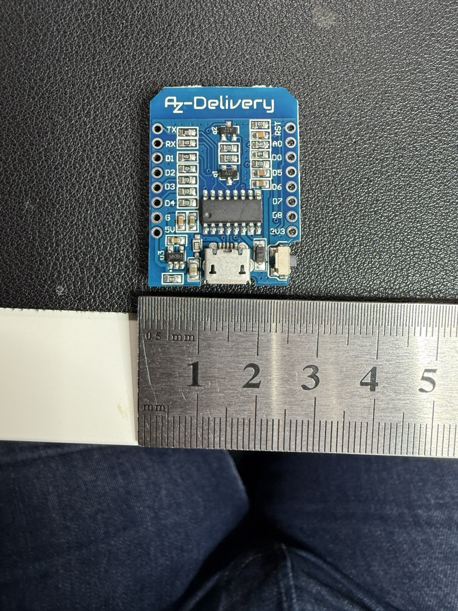
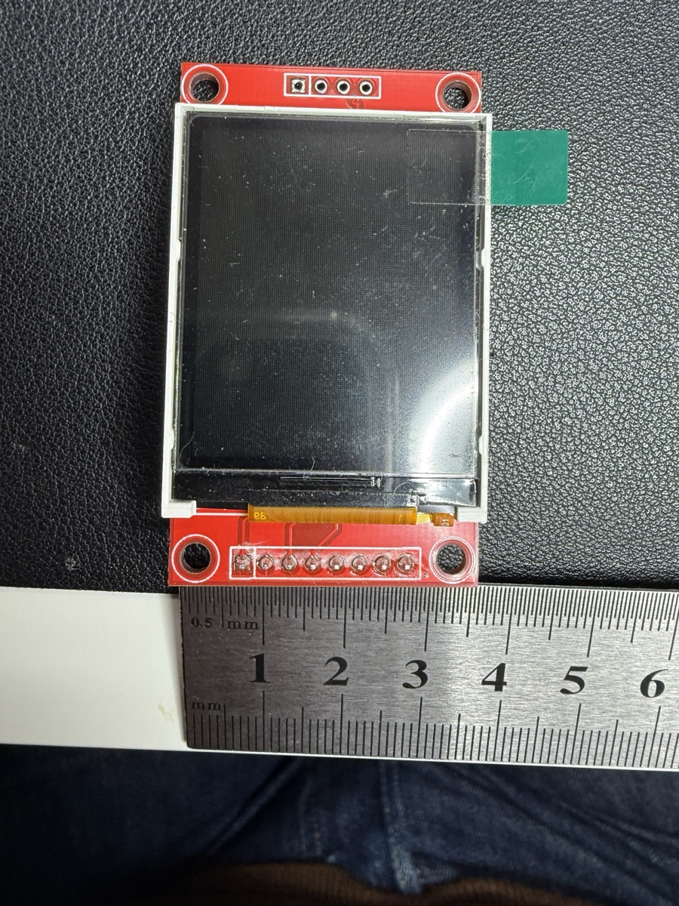
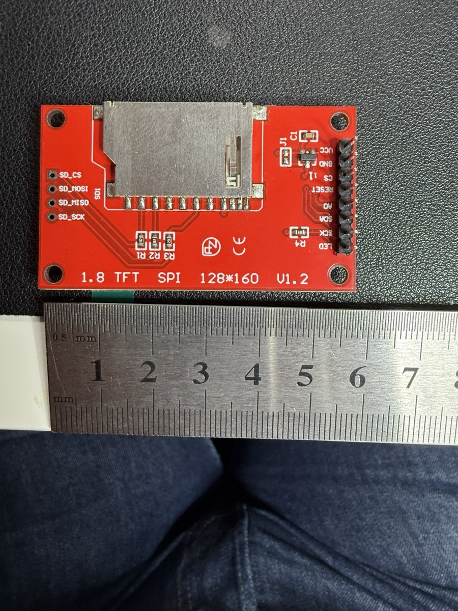
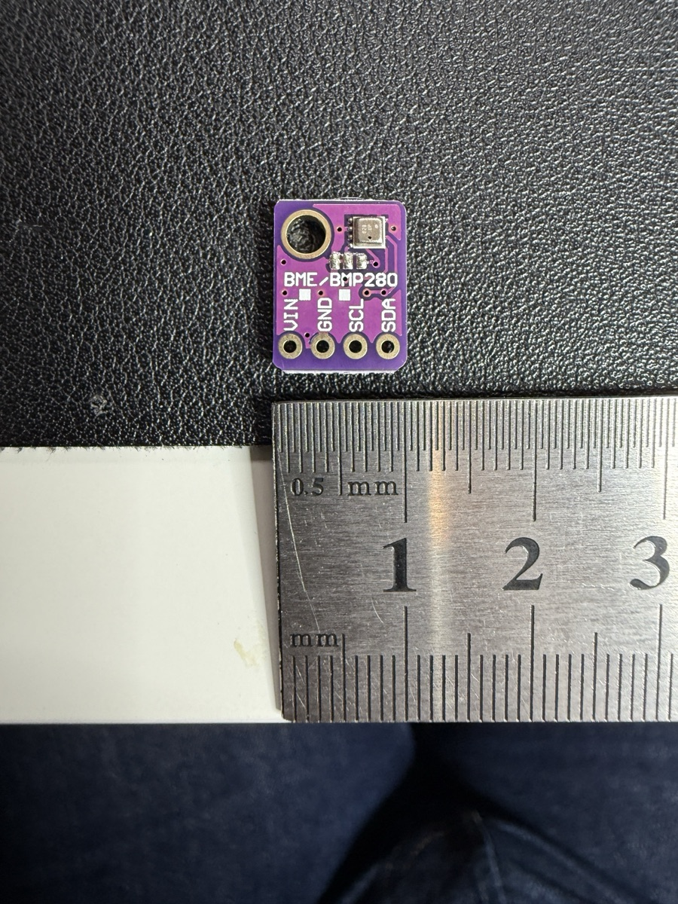
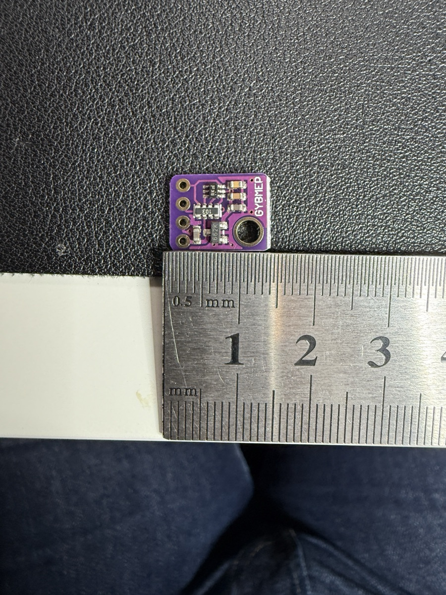
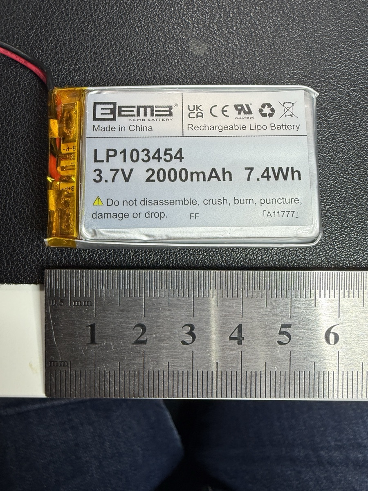

# Hardware

Stand: M0 läuft. Die Angaben stammen aus Fotos der vorhandenen Teile mit Lineal (`assets/photos/`).
Maße mit „ca.“ sind am Foto abgelesen und werden noch mit dem Messschieber bestätigt. Es wird nur die bereits
vorhandene Hardware verwendet; nichts wird ersetzt oder umgebaut.

## Bauteile

### ESP8266-Board: AZ-Delivery D1 mini

| Oberseite | Unterseite |
|---|---|
|  |  |

| Merkmal | Wert | Status |
|---|---|---|
| Variante | AZ-Delivery D1 mini (Bauform Wemos/LOLIN D1 mini), Modul `ESP8266MOD 12-F` | Foto |
| Pins | oben: `TX RX D1 D2 D3 D4 G 5V`, unten: `RST A0 D0 D5 D6 D7 D8 3V3` | Foto |
| Abmessungen | ca. 34 × 26 mm (D1-mini-Bauform: 34,2 × 25,6 mm) | Messschieber **offen** |
| Befestigungsbohrungen | keine – Befestigung über die Lötaugen der Stiftleisten | Foto |
| USB | Micro-USB, USB-Seriell-Chip im SO-16-Gehäuse (vermutlich CH340) | Aufdruck **offen** |
| 3,3-V-Regler | SOT-23-5, Aufdruck `MK8H` (U3) | Typ **offen** |
| Reset-Taster | seitlich neben der USB-Buchse | Foto |
| Auto-Reset | zwei Transistoren `J3Y` (S8050) | Foto |
| Teiler an `A0` | auf dem Board, bei der D1-mini-Bauform 220 kΩ / 100 kΩ (Messbereich 0–3,2 V) | Widerstandswerte **offen** |

Die D-Bezeichnungen entsprechen dem NodeMCU-Schema (D0 = GPIO16, D1 = GPIO5, D2 = GPIO4, D3 = GPIO0,
D4 = GPIO2, D5 = GPIO14, D6 = GPIO12, D7 = GPIO13, D8 = GPIO15). Damit gilt die Pinbelegung aus
[wiring.md](wiring.md) unverändert.

### TFT-Display

| Vorderseite | Rückseite |
|---|---|
|  |  |

| Merkmal | Wert | Status |
|---|---|---|
| Platine | rot, Aufdruck `1.8 TFT SPI 128*160 V1.2` | Foto |
| Abmessungen | ca. 35 × 58 mm | Messschieber **offen** |
| Befestigung | vier Bohrungen Ø 3 mm in den Ecken, Mittenabstand 28 × 52 mm | gemessen |
| Auflösung | 128 × 160 Pixel, Betrieb im Hochformat | Aufdruck |
| Controller | vermutlich ST7735S; die grüne Lasche der Schutzfolie deutet auf die Variante `INITR_GREENTAB` hin | Smoke-Test (M1) |
| Displayanschlüsse | 8-polige Stiftleiste, Reihenfolge `VCC GND CS RESET A0 SDA SCK LED` | Foto |
| microSD-Anschlüsse | `SD_CS SD_MOSI SD_MISO SD_SCK`, eigene Lötaugen auf der Gegenseite | wird nicht genutzt |
| Versorgung | Regler U1 (SOT-23) an `VCC`, daneben Lötbrücke J1 | Funktion **prüfen** |
| Hintergrundbeleuchtung | `LED` über Vorwiderstand R4 | Wert **offen** |

**Versorgung:** Bei diesen Modulen ist U1 üblicherweise ein 3,3-V-Regler für 5-V-Betrieb; eine geschlossene J1
überbrückt ihn für 3,3-V-Betrieb. An 3,3 V läuft das Modul auch mit offener J1, allerdings mit etwas weniger als
3,3 V hinter dem Regler. Vor dem Brücken von J1 wird mit dem Multimeter geprüft, dass J1 tatsächlich U1 überbrückt.

### BME280-Modul (Innenklima)

| Oberseite | Unterseite |
|---|---|
|  |  |

| Merkmal | Wert | Status |
|---|---|---|
| Modul | lila, Aufdruck `BME/BMP280`, Rückseite `GYBMEP` | Foto |
| Abmessungen | ca. 10 × 13 mm, eine Bohrung | Messschieber **offen** |
| Anschlüsse | `VIN GND SCL SDA` | Foto |
| Versorgung | 3,3-V-Regler `662K` (XC6206) und Pegelwandler auf dem Modul; `VIN` 3,3–5 V | Foto |
| Pull-ups | 10-kΩ-Widerstandsnetz `103` für SCL/SDA auf dem Modul | Foto |
| Schnittstelle | I²C, Adresse vermutlich 0x76 | I²C-Scan **offen** |
| Echtheit | Aufdruck passt zu beiden Sensoren. Chip-ID 0x60 = BME280, 0x58 = BMP280 ohne Feuchte | Chip-ID **offen** |

Der Aufdruck `BME/BMP280` heißt nur, dass die Platine für beide Sensoren gemacht ist. Ob ein BME280 bestückt ist,
zeigt erst die Chip-ID. Ein BMP280 liefert keine Luftfeuchte; die Innenanzeige müsste dann ohne sie auskommen.

An 3,3 V bleibt hinter dem Modulregler etwas weniger als 3,3 V übrig. Das reicht dem Sensor (ab 1,71 V).

### Akku: EEMB LP103454

| Hochkant | Quer |
|---|---|
|  |  |

| Merkmal | Wert | Status |
|---|---|---|
| Typ | LiPo-Pouchzelle EEMB LP103454, 3,7 V, 2000 mAh, 7,4 Wh | Aufdruck |
| Abmessungen | 10 × 34 × 54 mm laut Typbezeichnung, mit Schutzplatine ca. 57 mm lang | Foto |
| Schutzschaltung | ja, Schutzplatine unter Kapton am Kopfende (`B+ B- P+ P-`) | Foto |
| Anschluss | rote/schwarze Litze | Stecker **offen** |
| Zulassung | UL1642 (Zelle) | Aufdruck |

Die Zelle ist flach und weich. Sie steht im Käfig in einer Akkuwanne aus Lochraster und wird oben von einem
Drahtband mit Schrumpfschlauch gehalten, nirgends geklemmt, damit kein Messing auf die Pouchfolie drückt
(siehe [design.md](design.md)).

### Noch nicht gesichtet

| Teil | Anforderung | Status |
|---|---|---|
| Lademodul | USB-Laden für eine LiPo-Zelle, möglichst mit Lastweiche (Load-Sharing) und Schutz | **offen** |
| Spannungsregler | 3,3 V aus 3,0–4,2 V, mind. 500 mA für WLAN-Spitzen – oder der Regler des D1 mini (siehe unten) | **offen** |
| Selbsthalteschaltung | Logikpegel-P-MOSFET, NPN-Transistor, Widerstände, Diode | Typen **offen** |
| Taster | Drucktaster, schließend | **offen** |

**Regler des D1 mini:** Statt eines eigenen LDO könnte der geschaltete Akku an `5V` des D1 mini gehen; dann
versorgt dessen Regler U3 alles. Das klappt nur, wenn U3 ein Regler mit kleinem Spannungsabfall ist und bei
WLAN-Spitzen auch mit fast leerem Akku noch 3,3 V hält. Entschieden wird das, wenn der Typ von U3 feststeht.

Warum Selbsthalteschaltung statt Deep Sleep: Ein Entwicklungsboard zieht auch im Deep Sleep über USB-Seriell-Chip,
Regler und LED oft 10–20 mA. Die Selbsthalteschaltung trennt alles vom Akku; im Ruhezustand fließt praktisch kein Strom.

## Offene Prüfungen (M0)

- [x] Platinen und Akku mit Lineal fotografieren und in `assets/photos/` ablegen
- [x] ESP8266-Variante bestimmen: AZ-Delivery D1 mini mit ESP-12F
- [x] Pinreihenfolge am TFT ablesen
- [x] BME280-Modul: Versorgung 3,3–5 V (Regler und Pegelwandler auf dem Modul)
- [x] Akku bestimmen: LP103454, 2000 mAh, mit Schutzplatine
- [x] Bohrungen am TFT messen: Ø 3 mm, Mittenabstand 28 × 52 mm
- [ ] Außenmaße mit dem Messschieber bestätigen (TFT, D1 mini, BME280)
- [ ] Aufdruck des USB-Seriell-Chips und Typ des Reglers U3 (`MK8H`) auf dem D1 mini bestimmen
- [ ] Widerstände des A0-Teilers auf dem D1 mini ablesen oder messen
- [ ] TFT: Funktion von J1 und U1 durchmessen, Wert von R4 ablesen
- [ ] BME280: I²C-Adresse und Chip-ID per Sketch auslesen (BME280 oder BMP280?)
- [ ] Displaycontroller und Tab-Variante im Smoke-Test bestimmen (M1)
- [ ] Lademodul, Taster, MOSFET und Transistoren in der Werkstatt sichten
- [ ] Strombedarf von ESP8266 + TFT im Betrieb messen
