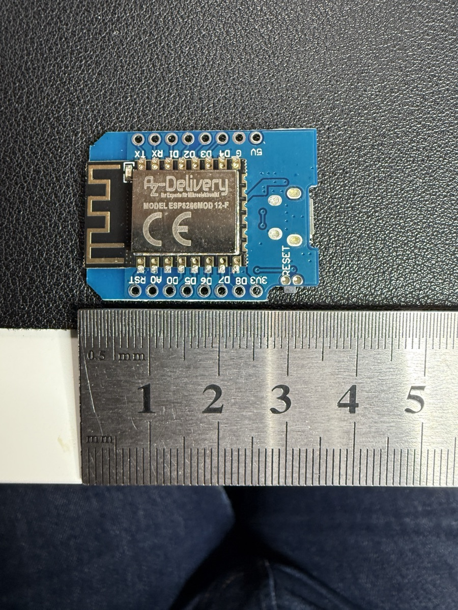
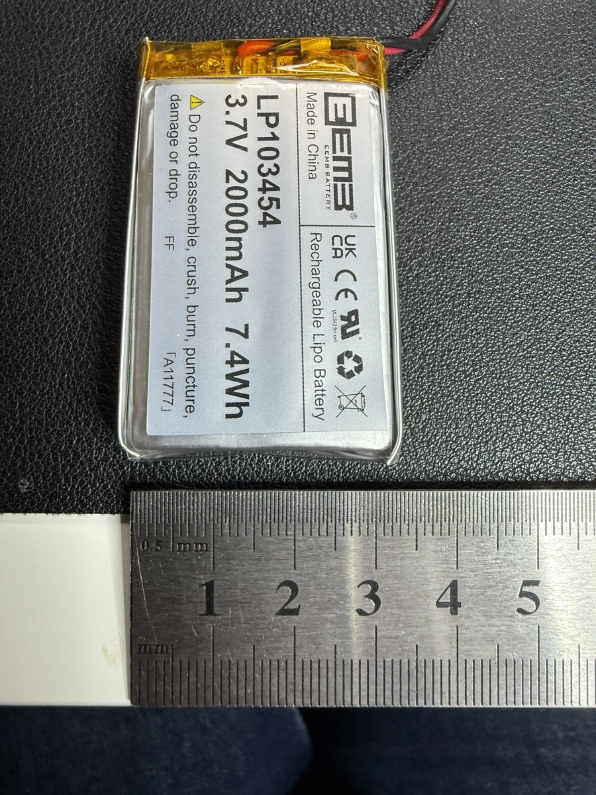
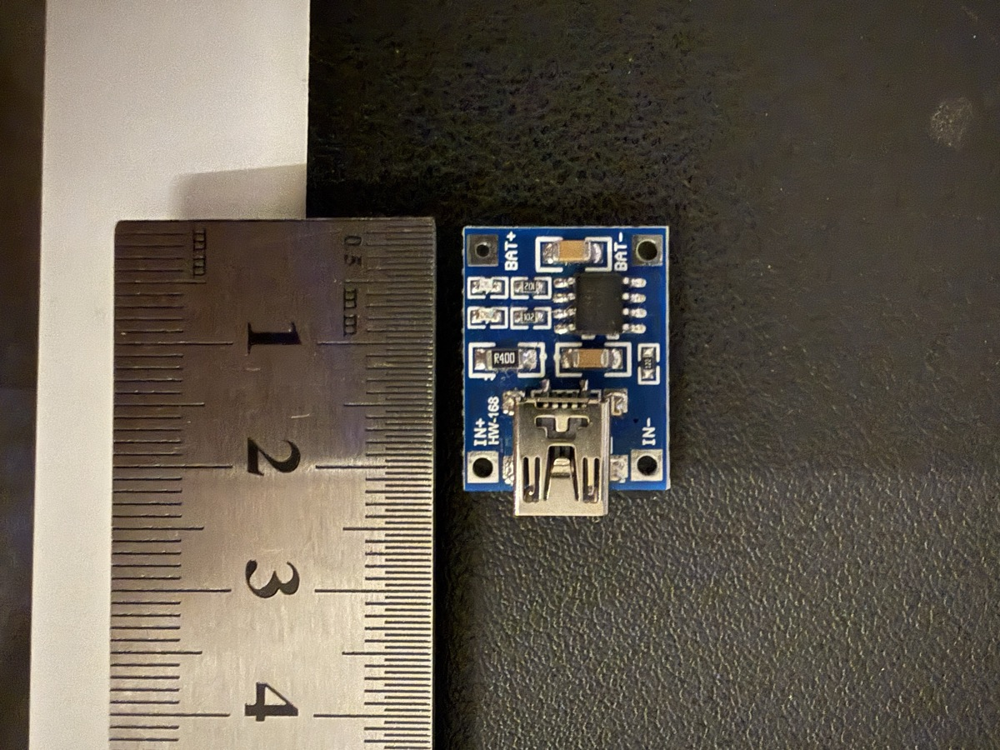
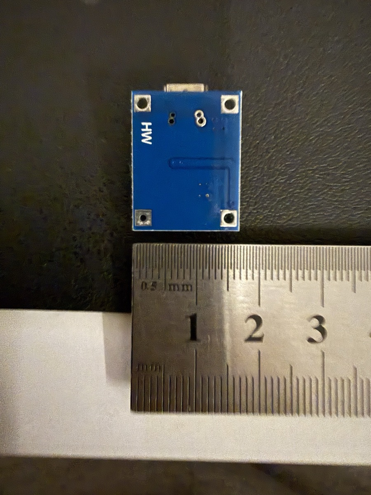
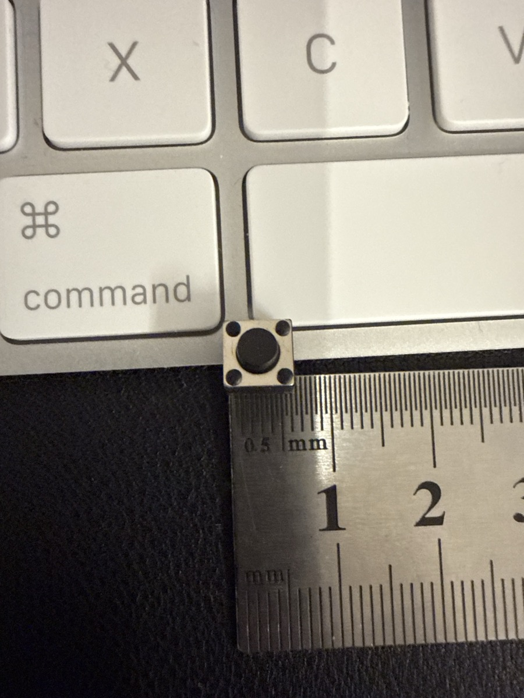
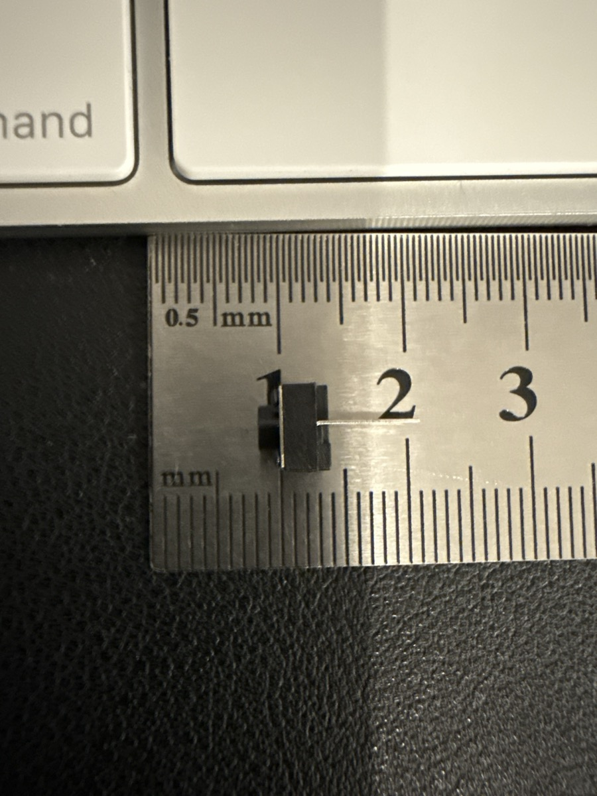

# Hardware

Stand: M0 läuft. Die Angaben stammen aus Fotos der vorhandenen Teile mit Lineal (`assets/photos/`).
Maße mit „ca.“ sind am Foto abgelesen und werden noch mit dem Messschieber bestätigt. Es wird nur die bereits
vorhandene Hardware verwendet; nichts wird ersetzt oder umgebaut.

## Bauteile

### ESP8266-Board: AZ-Delivery D1 mini

| Oberseite | Unterseite |
|---|---|
|  |  |

| Merkmal | Wert | Status |
|---|---|---|
| Variante | AZ-Delivery D1 mini (Bauform Wemos/LOLIN D1 mini), Modul `ESP8266MOD 12-F` | Foto |
| Pins | oben: `TX RX D1 D2 D3 D4 G 5V`, unten: `RST A0 D0 D5 D6 D7 D8 3V3` | Foto |
| Abmessungen | ca. 34 × 26 mm (D1-mini-Bauform: 34,2 × 25,6 mm) | Messschieber **offen** |
| Befestigungsbohrungen | keine – Befestigung über die Lötaugen der Stiftleisten | Foto |
| USB | Micro-USB, USB-Seriell-Chip im SO-16-Gehäuse ohne Aufdruck; kein Quarz daneben, also vermutlich CH340C | [Detailfoto](../assets/photos/d1mini-detail.jpg) |
| 3,3-V-Regler | SOT-23-5, Aufdruck `MK8H` (U3); der Code ist keinem Typ zuzuordnen | Typ **unbekannt** |
| Reset-Taster | seitlich neben der USB-Buchse | Foto |
| Auto-Reset | zwei Transistoren `J3Y` (S8050) | Foto |
| Teiler an `A0` | 220 kΩ (`224`) / 100 kΩ (`104`) auf dem Board, Messbereich 0–3,2 V | Aufdruck |

Die D-Bezeichnungen entsprechen dem NodeMCU-Schema (D0 = GPIO16, D1 = GPIO5, D2 = GPIO4, D3 = GPIO0,
D4 = GPIO2, D5 = GPIO14, D6 = GPIO12, D7 = GPIO13, D8 = GPIO15). Damit gilt die Pinbelegung aus
[wiring.md](wiring.md) unverändert.

### TFT-Display

| Vorderseite | Rückseite |
|---|---|
|  |  |

| Merkmal | Wert | Status |
|---|---|---|
| Platine | rot, Aufdruck `1.8 TFT SPI 128*160 V1.2` | Foto |
| Abmessungen | ca. 35 × 58 mm | Messschieber **offen** |
| Befestigung | vier Bohrungen Ø 3 mm in den Ecken, Mittenabstand 28 × 52 mm | gemessen |
| Auflösung | 128 × 160 Pixel, Betrieb im Hochformat | Aufdruck |
| Controller | vermutlich ST7735S; die grüne Lasche der Schutzfolie deutet auf die Variante `INITR_GREENTAB` hin | Smoke-Test (M1) |
| Displayanschlüsse | 8-polige Stiftleiste, Reihenfolge `VCC GND CS RESET A0 SDA SCK LED` | Foto |
| microSD-Anschlüsse | `SD_CS SD_MOSI SD_MISO SD_SCK`, eigene Lötaugen auf der Gegenseite | wird nicht genutzt |
| Versorgung | Regler U1 `662K` = XC6206P332 (3,3 V, 200 mA) an `VCC`, daneben Lötbrücke J1 – **offen** | [Detailfoto](../assets/photos/tft-detail.jpg) |
| Hintergrundbeleuchtung | `LED` über Vorwiderstand R4 = 3,3 Ω (`3R3`) | Strom **messen** |

**Versorgung:** U1 ist ein XC6206 für den Betrieb an 5 V; eine geschlossene J1 würde ihn überbrücken. Die Fähre
versorgt das TFT mit 3,3 V und lässt J1 **offen**: Hinter U1 bleiben bei dem kleinen Strom des Controllers etwa
3,2 V, das reicht dem ST7735. Es muss also nichts gelötet werden.

**Hintergrundbeleuchtung:** R4 hat nur 3,3 Ω. Die LEDs der Beleuchtung brauchen etwa 3,0–3,2 V; an 3,3 V fließen
damit grob 30–60 mA, je nach Exemplar. Das ist der größte Dauerverbraucher neben dem ESP8266. Der Strom wird im
Smoke-Test gemessen; ist er hoch, kommt ein zusätzlicher Vorwiderstand von 10–22 Ω in die `LED`-Leitung.

### BME280-Modul (Innenklima)

| Oberseite | Unterseite |
|---|---|
|  |  |

| Merkmal | Wert | Status |
|---|---|---|
| Modul | lila, Aufdruck `BME/BMP280`, Rückseite `GYBMEP` | Foto |
| Abmessungen | ca. 10 × 13 mm, eine Bohrung | Messschieber **offen** |
| Anschlüsse | `VIN GND SCL SDA` | Foto |
| Versorgung | 3,3-V-Regler `662K` (XC6206) und Pegelwandler auf dem Modul; `VIN` 3,3–5 V | Foto |
| Pull-ups | 10-kΩ-Widerstandsnetz `103` für SCL/SDA auf dem Modul | Foto |
| Schnittstelle | I²C, Adresse vermutlich 0x76 | I²C-Scan **offen** |
| Echtheit | Aufdruck passt zu beiden Sensoren. Chip-ID 0x60 = BME280, 0x58 = BMP280 ohne Feuchte | Chip-ID **offen** |

Der Aufdruck `BME/BMP280` heißt nur, dass die Platine für beide Sensoren gemacht ist. Ob ein BME280 bestückt ist,
zeigt erst die Chip-ID. Ein BMP280 liefert keine Luftfeuchte; die Innenanzeige müsste dann ohne sie auskommen.

An 3,3 V bleibt hinter dem Modulregler etwas weniger als 3,3 V übrig. Das reicht dem Sensor (ab 1,71 V).

### Akku: EEMB LP103454

| Hochkant | Quer |
|---|---|
|  |  |

| Merkmal | Wert | Status |
|---|---|---|
| Typ | LiPo-Pouchzelle EEMB LP103454, 3,7 V, 2000 mAh, 7,4 Wh | Aufdruck |
| Abmessungen | 10 × 34 × 54 mm laut Typbezeichnung, mit Schutzplatine ca. 57 mm lang | Foto |
| Schutzschaltung | ja, Schutzplatine unter Kapton am Kopfende (`B+ B- P+ P-`) | Foto |
| Anschluss | rote/schwarze Litze | Stecker **offen** |
| Zulassung | UL1642 (Zelle) | Aufdruck |

Die Zelle ist flach und weich. Sie steht im Käfig in einer Akkuwanne aus Lochraster und wird oben von einem
Drahtband mit Schrumpfschlauch gehalten, nirgends geklemmt, damit kein Messing auf die Pouchfolie drückt
(siehe [design.md](design.md)).

### Lademodul: HW-168 (TP4056)

| Oberseite | Unterseite |
|---|---|
|  |  |

| Merkmal | Wert | Status |
|---|---|---|
| Modul | blau, Aufdruck `HW-168`, Ladechip `4056E` (TP4056, SOP-8), am Eingang 0,4 Ω (`R400`) | Foto |
| Abmessungen | ca. 16 × 20 mm, Mini-USB-Buchse steht ca. 3 mm über | Messschieber **offen** |
| Anschlüsse | `IN+ IN−` neben der USB-Buchse, `BAT+ BAT−` am anderen Ende; vier Lötaugen mit Bohrung | Foto |
| Schutzschaltung | keine (kein DW01, kein MOSFET) – der Akku hat eine eigene Schutzplatine | Foto |
| Lastausgang | keiner (`OUT+`/`OUT−` fehlen), die Last hängt direkt an `BAT+`/`BAT−` | Foto |
| Ladestrom | PROG-Widerstand `122` = 1,2 kΩ → 1 A, also 0,5 C bei 2000 mAh; volle Ladung in gut 2 Stunden | [Detailfoto](../assets/photos/lademodul-detail.jpg) |
| Ladeanzeige | zwei LEDs mit je 1 kΩ (`102`) | Farben **prüfen** |

**Laden nur bei ausgeschaltetem Gerät:** Ohne Lastausgang zieht ein laufender ESP8266 seinen Strom mitten aus dem
Ladekreis. Der TP4056 sieht dann nie den kleinen Endstrom und schaltet nicht sauber ab. Weil die
Selbsthalteschaltung die Fähre im Ruhezustand ganz vom Akku trennt, ist das im Alltag kein Problem: einstecken, wenn
die Fähre aus ist. Kurzes Einschalten beim Laden schadet nicht.

`IN−` und `BAT−` sind auf dem Modul verbunden und liegen auf GND. Damit kann das Modul über das `BAT−`-Lötauge
direkt am Messinggestell (GND) angelötet werden.

### Taster

| Oben | Seite |
|---|---|
|  |  |

| Merkmal | Wert | Status |
|---|---|---|
| Typ | Kurzhubtaster 6 × 6 mm, Metalldeckel, schwarzer Stößel, schließend | Foto |
| Höhe | ca. 5 mm mit Stößel | Foto |
| Beinchen | **2 Stück**, gerade nach unten, ca. 7 mm lang | Foto |
| Beinabstand | vermutlich 6,5 mm, gegenüberliegend | Messen **offen** |

Der Taster liegt mittig auf dem Querstab im Deckrahmen, die Beinchen zeigen nach vorn und hinten. So drückt jeder
Tastendruck den Körper auf den Draht, nicht auf die Lötstelle. Das vordere Beinchen wird zum Querstab gebogen und
angelötet (GND, zugleich die Befestigung). Das hintere Beinchen bleibt frei und bekommt den Kupferlackdraht zu `BTN`;
zum Querstab bleiben gut 2 mm Luft.

### Geprüft und nicht verwendet

| Teil | Grund |
|---|---|
| Step-down-Modul LM2596 (HW-411), ca. 43 × 21 mm | braucht 1,5–2 V mehr am Eingang, als es abgibt; aus dem LiPo (3,0–4,2 V) kommen keine stabilen 3,3 V. Außerdem zu groß für den Käfig und hoher Eigenverbrauch |
| zweites Lademodul TP4056 mit Schutz (`OUT+ B+ B− OUT−`) | Reserve; das kleinere HW-168 genügt, weil der Akku eine eigene Schutzplatine hat |

### Noch nicht gesichtet

| Teil | Anforderung | Status |
|---|---|---|
| Spannungsregler | 3,3 V aus 3,0–4,2 V, mind. 500 mA für WLAN-Spitzen (AP2112K-3.3, ME6211C33, HT7833) – oder der Regler des D1 mini (siehe unten). Nicht vorhanden. Typen mit 200–250 mA (HT7333, MCP1700, XC6206) reichen nicht | **beschaffen** |
| Selbsthalteschaltung | P-MOSFET AO3401, NPN BC547, 2 × BAT85, 3 × 100 kΩ, 2 × 10 kΩ – nicht vorhanden | **beschaffen** |

**Regler des D1 mini:** Statt eines eigenen LDO könnte der geschaltete Akku an `5V` des D1 mini gehen; dann
versorgt dessen Regler U3 alles. Das klappt nur, wenn U3 ein Regler mit kleinem Spannungsabfall ist und bei
WLAN-Spitzen auch mit fast leerem Akku noch 3,3 V hält. Der Typ von U3 lässt sich am Aufdruck `MK8H` nicht bestimmen. Deshalb bekommt die Fähre ihren eigenen LDO U2; Leistung
und Spannungsabfall sind dann bekannt. Wer U2 sparen möchte, kann U3 im Aufbau testen: Akku über die Selbsthaltung an
`5V`, WLAN senden lassen und `3V3` bei einer Akkuspannung um 3,4 V messen.

Warum Selbsthalteschaltung statt Deep Sleep: Ein Entwicklungsboard zieht auch im Deep Sleep über USB-Seriell-Chip,
Regler und LED oft 10–20 mA. Die Selbsthalteschaltung trennt alles vom Akku; im Ruhezustand fließt praktisch kein Strom.

## Offene Prüfungen (M0)

- [x] Platinen und Akku mit Lineal fotografieren und in `assets/photos/` ablegen
- [x] ESP8266-Variante bestimmen: AZ-Delivery D1 mini mit ESP-12F
- [x] Pinreihenfolge am TFT ablesen
- [x] BME280-Modul: Versorgung 3,3–5 V (Regler und Pegelwandler auf dem Modul)
- [x] Akku bestimmen: LP103454, 2000 mAh, mit Schutzplatine
- [x] Bohrungen am TFT messen: Ø 3 mm, Mittenabstand 28 × 52 mm
- [ ] Außenmaße mit dem Messschieber bestätigen (TFT, D1 mini, BME280)
- [x] USB-Seriell-Chip: ohne Aufdruck, ohne Quarz, vermutlich CH340C
- [x] Regler U3 (`MK8H`): Typ nicht bestimmbar → eigener LDO U2
- [x] A0-Teiler auf dem D1 mini: 220 kΩ / 100 kΩ
- [x] TFT: U1 = XC6206 (`662K`), J1 offen und bleibt offen, R4 = 3,3 Ω
- [ ] TFT: Strom der Hintergrundbeleuchtung an 3,3 V messen
- [ ] BME280: I²C-Adresse und Chip-ID per Sketch auslesen (BME280 oder BMP280?)
- [ ] Displaycontroller und Tab-Variante im Smoke-Test bestimmen (M1)
- [x] Lademodul bestimmen: HW-168 mit TP4056, ohne Schutz und ohne Lastausgang
- [x] Lademodul: Ladestrom 1 A (PROG-Widerstand 1,2 kΩ)
- [ ] Lademodul: LED-Farben beim Laden prüfen
- [x] Taster bestimmen: 6 × 6 mm, ca. 5 mm hoch, zwei Beinchen
- [ ] Taster: Abstand der zwei Beinchen messen
- [x] Bestand gesichtet: MOSFET, Transistor, Dioden, Widerstände und LDO nicht vorhanden → Einkaufsliste in [parts-list.md](parts-list.md)
- [ ] Strombedarf von ESP8266 + TFT im Betrieb messen
