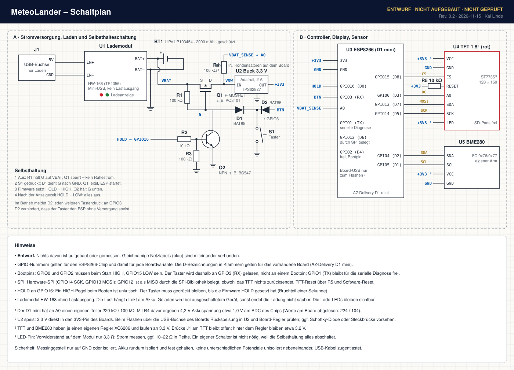
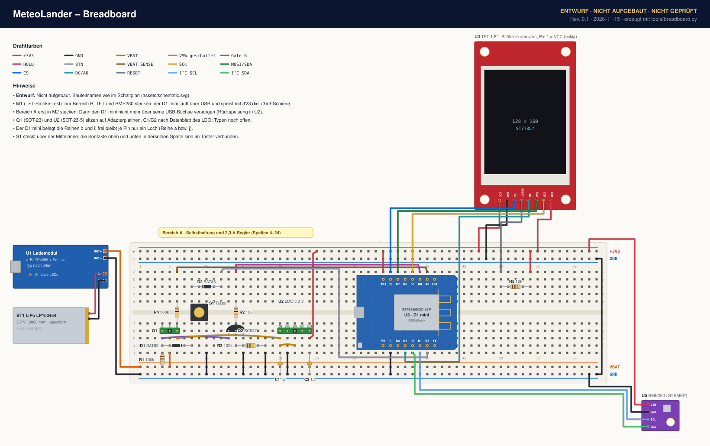

# Verdrahtung

> [!IMPORTANT]
> **Entwurf, nicht aufgebaut und nicht geprüft.** Board (AZ-Delivery D1 mini) und Pinreihenfolge am TFT sind
> anhand von Fotos bestimmt. Gültig wird die Belegung erst nach dem Smoke-Test (M1) und dem Aufbau auf dem
> Breadboard.



## Breadboard



Testaufbau auf einem Steckbrett mit 830 Kontakten, erzeugt mit `tools/breadboard.py`. Bereich A (Spalten 4–24)
enthält Selbsthaltung und Regler, der D1 mini steckt um 180° gedreht in den Spalten 34–41 (USB links, Antenne
rechts frei). Für M1 reicht der D1 mini an USB mit TFT und BME280; Bereich A folgt in M2. Sobald Bereich A steckt,
wird der D1 mini nicht mehr über seine eigene USB-Buchse versorgt.

## Pinbelegung (Vorschlag)

Board: AZ-Delivery D1 mini. Seine D-Bezeichnungen folgen dem NodeMCU-Schema, die Tabelle gilt deshalb unverändert.

| ESP8266 | Board | Signal | Ziel | Begründung |
|---|---|---|---|---|
| GPIO14 | D5 | SCK | TFT `SCK` | Hardware-SPI |
| GPIO13 | D7 | MOSI | TFT `SDA` | Hardware-SPI |
| GPIO15 | D8 | CS | TFT `CS` | Hardware-SPI-CS; Pull-down auf dem Board passt zum Bootpegel LOW |
| GPIO0 | D3 | DC | TFT `A0` | Ausgang erst nach dem Boot; das TFT zieht den Pin nicht herunter |
| GPIO4 | D2 | SDA | BME280 `SDA` | Standard-I²C des ESP8266-Cores |
| GPIO5 | D1 | SCL | BME280 `SCL` | Standard-I²C des ESP8266-Cores |
| GPIO16 | D0 | HOLD | Q2 über R2 | HIGH beim Booten ist unkritisch |
| GPIO3 | RX | BTN | Taster über D2 | kein Bootpin; TX bleibt für die Diagnose frei |
| A0 | A0 | VBAT_SENSE | R4 | einziger Analogeingang |
| GPIO12 | D6 | – | – | durch die SPI-Bibliothek als MISO belegt |
| GPIO2 | D4 | – | frei | Bootpin, muss beim Start HIGH sein |
| GPIO1 | TX | – | seriell | Diagnoseausgabe |

TFT `RESET` liegt über R5 (10 kΩ) an +3V3, der Reset erfolgt per Software. TFT `LED` liegt an +3V3; das Modul hat
dafür einen eigenen Vorwiderstand (R4 auf dem Modul). Die microSD-Anschlüsse bleiben unbeschaltet.

Stiftleiste am TFT (Pin 1 = eckiges Lötauge): `VCC GND CS RESET A0 SDA SCK LED`.
Anschlüsse am BME280-Modul: `VIN GND SCL SDA`; das Modul hat eigenen Regler, Pegelwandler und Pull-ups.

## Ladeanzeige

Die LEDs des Lademoduls („lädt“ rot, „voll“ grün o. ä.) sitzen sichtbar an der rechten Seite der Fähre. Sie zeigen den
Ladezustand auch bei ausgeschaltetem Gerät. Ein Ladesymbol auf dem Display bräuchte einen weiteren freien,
bootsicheren GPIO; den gibt es in dieser Belegung nicht. Das Display zeigt stattdessen den Akkustand.

## Stromversorgung mit Selbsthalteschaltung

Das Lademodul HW-168 hat keinen Lastausgang. Die Selbsthaltung hängt deshalb direkt an `BAT+`, also am Akku.
Geladen wird bei ausgeschaltetem Gerät (siehe [hardware.md](hardware.md)).

```text
USB ──▶ Lademodul HW-168 ──▶ Akku (mit Schutz)
                         │
                         ▼
                    P-MOSFET (Schalter) ──▶ 3,3-V-Regler ──▶ ESP8266, TFT, BME280
                         ▲      ▲
       Taster nach GND ──┘      └── Transistor ◀── GPIO „Halten“ des ESP8266
```

1. **Aus:** Ein Pull-up hält das Gate des P-MOSFET hoch, der Schalter sperrt, es fließt kein Strom.
2. **Einschalten:** Der Taster zieht das Gate auf GND, die Elektronik bekommt Strom und startet.
3. **Halten:** Die Firmware setzt sofort beim Start den Halte-GPIO, der Transistor hält das Gate unten.
   Der Taster darf losgelassen werden.
4. **Ausschalten:** Nach der Anzeigezeit nimmt die Firmware den Halte-GPIO zurück und schaltet sich damit selbst ab.

Der Taster wird zusätzlich über D2 an GPIO3 gelesen, damit ein weiterer Tastendruck im Betrieb erkannt wird
(z. B. zum Umschalten der Ansicht). Offen: endgültige Bauteiltypen nach Werkstattbestand und die Zeit, die der Taster
beim Einschalten gedrückt bleiben muss.

## Akkuspannung

Über R4 (100 kΩ) an `A0`. Der D1 mini hat an `A0` bereits einen Teiler (220 kΩ / 100 kΩ, Messbereich 0–3,2 V);
mit R4 davor ergeben 4,2 V am Akku etwa 1,0 V am ADC des Chips. Die Widerstände auf dem Board werden noch
nachgemessen. R4 sitzt hinter dem MOSFET und verbraucht im ausgeschalteten Zustand nichts.

## Regeln für die Pinwahl

- Hardware-SPI des ESP8266 verwenden, wenn die Boardvariante es erlaubt.
- Bootstrapping-Pins (beim ESP8266 GPIO0, GPIO2 und GPIO15) nur nutzen, wenn ihr Pegel beim Start nicht gestört wird.
- Jede Zuordnung wird hier mit Begründung eingetragen und im Smoke-Test bestätigt.

## Sicherheit am offenen Aufbau

- Das Messinggestell liegt kontrolliert auf GND oder ist vollständig isoliert – nie auf einem anderen Potenzial.
- Keine unterschiedlichen Versorgungspotenziale unisoliert nebeneinander.
- Das USB-Kabel wird am Gestell zugentlastet.
- Der Akku hat eine Schutzschaltung, ist rundum isoliert und mechanisch fest gehalten; er berührt das Gestell nirgends blank.
